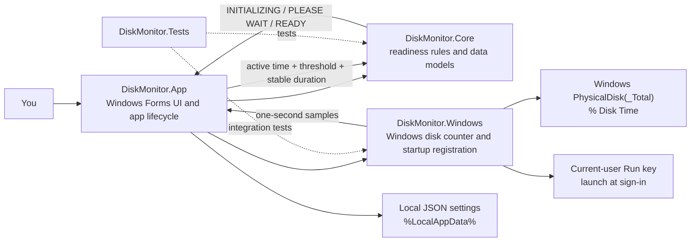
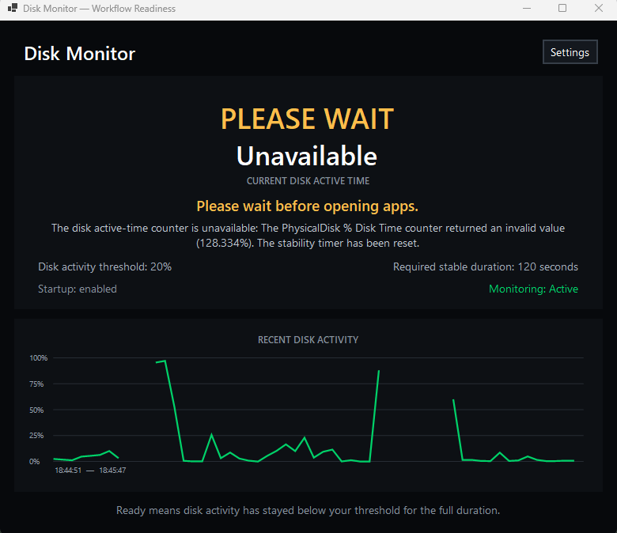
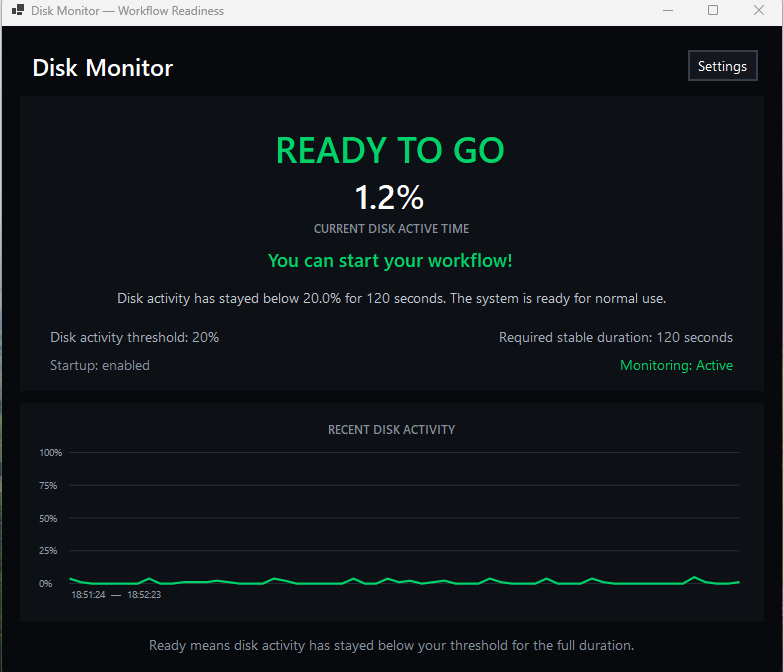

# Disk Monitor

Disk Monitor is a lightweight Windows 11 startup-readiness dashboard. It samples
the aggregate physical disk's active time once per second and reports **READY**
only after activity stays below the configured threshold continuously for the
configured duration.

## Architecture



The four projects have separate jobs:

- **DiskMonitor.App** — Windows Forms dashboard and application lifecycle.
- **DiskMonitor.Core** — plain C# types and readiness rules; it has no Windows API dependency.
- **DiskMonitor.Windows** — Windows disk-counter collection and current-user startup registration.
- **DiskMonitor.Tests** — xUnit tests for readiness rules, configuration, startup registration, and real Windows counter collection.

### Understanding the code (Python developer guide)

The projects are like separate Python packages. Here is what the main source
files do:

**DiskMonitor.App — the user interface**

- [`Program.cs`](./DiskMonitor.App/Program.cs) is the entry point, similar to
  the Python file that starts the application. It initializes Windows Forms
  and opens the main window.
- [`Forms/MainForm.cs`](./DiskMonitor.App/Forms/MainForm.cs) creates the
  dashboard, starts monitoring in the background, sends each update to the UI
  thread, and cancels and waits for monitoring when the window closes.
- [`Forms/SettingsForm.cs`](./DiskMonitor.App/Forms/SettingsForm.cs) builds the
  small settings window for the active-time threshold and stable duration.
- [`Controls/ActivityChart.cs`](./DiskMonitor.App/Controls/ActivityChart.cs)
  is a custom Windows Forms control. It paints the recent samples as a graph.
- [`Startup/ReadinessSettings.cs`](./DiskMonitor.App/Startup/ReadinessSettings.cs)
  defines the settings values. [`Startup/StartupSettingsStore.cs`](./DiskMonitor.App/Startup/StartupSettingsStore.cs)
  loads and saves them as JSON under the user's Local AppData folder.
- [`Properties/PublishProfiles/win-x64.pubxml`](./DiskMonitor.App/Properties/PublishProfiles/win-x64.pubxml)
  configures the self-contained Windows x64 single-file publish.
- [`DiskMonitor.App.csproj`](./DiskMonitor.App/DiskMonitor.App.csproj) tells
  .NET this is a Windows Forms executable and lists its project references.

**DiskMonitor.Core — the portable rules and data**

- [`Interfaces/IDiskActiveTimeProvider.cs`](./DiskMonitor.Core/Interfaces/IDiskActiveTimeProvider.cs)
  is a C# interface, roughly like a Python `Protocol`: it describes how code
  requests disk samples without specifying how Windows collects them.
- [`Models/DiskActiveTimeSample.cs`](./DiskMonitor.Core/Models/DiskActiveTimeSample.cs)
  holds one timestamped reading. A missing reading is represented as `null`,
  not as zero.
- [`Models/ReadinessState.cs`](./DiskMonitor.Core/Models/ReadinessState.cs)
  lists the possible states. [`Models/ReadinessUpdate.cs`](./DiskMonitor.Core/Models/ReadinessUpdate.cs)
  contains the state, reading, elapsed stable time, and explanation for the UI.
- [`Configuration/ReadinessOptions.cs`](./DiskMonitor.Core/Configuration/ReadinessOptions.cs)
  holds and validates the threshold and required duration.
- [`Services/ReadinessEvaluator.cs`](./DiskMonitor.Core/Services/ReadinessEvaluator.cs)
  contains the readiness rule. A high, invalid, or late reading resets the
  uninterrupted below-threshold timer.
- [`DiskMonitor.Core.csproj`](./DiskMonitor.Core/DiskMonitor.Core.csproj)
  targets plain .NET and does not reference Windows APIs.

**DiskMonitor.Windows — the Windows integration**

- [`Performance/WindowsDiskMetricsProvider.cs`](./DiskMonitor.Windows/Performance/WindowsDiskMetricsProvider.cs)
  opens Windows' `PhysicalDisk(_Total)\% Disk Time` counter. In this file,
  `counter` is the .NET `PerformanceCounter` object connected to that Windows
  metric; its `NextValue()` reads the counter. The first call initializes the
  performance-counter sample, and then the provider reads once per second.
  Values outside 0–100 or counter errors become unavailable samples. The
  counter is disposed when monitoring is cancelled.
- [`Startup/WindowsStartupRegistration.cs`](./DiskMonitor.Windows/Startup/WindowsStartupRegistration.cs)
  manages the app's current-user startup entry.
- [`Startup/IStartupEntryStore.cs`](./DiskMonitor.Windows/Startup/IStartupEntryStore.cs)
  defines the small storage interface used for startup entries.
- [`Startup/RegistryStartupEntryStore.cs`](./DiskMonitor.Windows/Startup/RegistryStartupEntryStore.cs)
  implements it using the current user's Windows Registry (no administrator
  access is needed).
- [`DiskMonitor.Windows.csproj`](./DiskMonitor.Windows/DiskMonitor.Windows.csproj)
  references Core and the .NET PerformanceCounter package.

**DiskMonitor.Tests — automated checks**

- [`Core/ReadinessEvaluatorTests.cs`](./DiskMonitor.Tests/Core/ReadinessEvaluatorTests.cs)
  checks readiness transitions, threshold resets, invalid readings, and timing.
- [`Startup/WindowsDiskMetricsProviderTests.cs`](./DiskMonitor.Tests/Startup/WindowsDiskMetricsProviderTests.cs)
  checks the real Windows disk counter and invalid counter values.
- [`Startup/WindowsStartupRegistrationTests.cs`](./DiskMonitor.Tests/Startup/WindowsStartupRegistrationTests.cs)
  checks current-user startup command behavior.
- [`Startup/StartupSettingsStoreTests.cs`](./DiskMonitor.Tests/Startup/StartupSettingsStoreTests.cs)
  checks JSON settings persistence and validation.
- [`DiskMonitor.Tests.csproj`](./DiskMonitor.Tests/DiskMonitor.Tests.csproj)
  lists the xUnit packages and projects under test.

**How one reading becomes a dashboard update**

1. `MainForm` asks the Windows provider for an asynchronous stream of samples.
2. `WindowsDiskMetricsProvider` reads the Windows performance counter each
   second and yields a timestamped sample.
3. `ReadinessEvaluator` applies the configured threshold and stable duration.
4. `MainForm` updates labels and adds the sample to `ActivityChart`.
5. On close, a `CancellationToken` signals the provider to stop and dispose its
   counter before the application exits.

In C#, `record` is a compact data type, similar to a frozen Python dataclass.
Nullable types such as `double?` mean a value may be absent. `IAsyncEnumerable`
is an asynchronous stream of values; `CancellationToken` is a cooperative
signal to stop background work. Windows-specific code lives outside Core so
the readiness rules can be tested independently.

### Screenshots

**Please wait** — the disk reading is currently unavailable in this capture, so the app does not count it as zero or advance the readiness timer.



**Ready to start your workflow** — disk activity has stayed under the threshold for the required duration.



The screenshot files are stored in `docs/screenshots` in this repository. To
show them in a GitHub README, include (commit and push) those image files along
with the README. If the image files are not in the repository, GitHub cannot
display these relative image links. The original copies you shared in chat are
not automatically uploaded to GitHub.

The app reads the Windows `% Disk Time` active-time counter directly, avoiding
negative values caused by subtracting a rounded `% Idle Time` reading from 100.
Invalid or unavailable readings are shown as unavailable, never as zero, and
reset the readiness timer. Disk activity is a measure of busy time, not a
diagnosis of disk failure or a guarantee that every application will perform
well.

## Installation and running

### Build from source

Requires Windows 11 and the .NET 10 SDK:

```powershell
dotnet build .\DiskMonitor.sln -c Release
dotnet test .\DiskMonitor.sln -c Release
dotnet run --project .\DiskMonitor.App\DiskMonitor.App.csproj
```

### Self-contained release

Publish a self-contained Windows x64 single-file executable:

```powershell
dotnet publish .\DiskMonitor.App\DiskMonitor.App.csproj -c Release -p:PublishProfile=win-x64
```

The app executable is written to
`artifacts\publish\win-x64-workflow\DiskMonitor.App.exe`. Copy it to a
user-writable folder and launch it; a separate .NET or Python installation is
not required.

## Startup configuration

On launch, Disk Monitor registers its executable in the current user's Windows
Run key so the dashboard opens at sign-in. Registration does not require
administrator access. If registration fails, the dashboard displays a warning.
To stop it starting automatically, remove the `DiskMonitor` value from
`HKCU\Software\Microsoft\Windows\CurrentVersion\Run`.

## Dashboard and readiness behavior

The dark dashboard prominently shows whether you can start your workflow or
should wait, along with current disk active time, stability progress, and a
recent-activity graph. Disk Monitor does not send toast or balloon
notifications. **Settings** lets you configure:

- The active-time threshold (default **20%**).
- How long activity must stay below that threshold (default **60 seconds**).

The status is **INITIALIZING** until the first valid counter sample is
available. It then shows **PLEASE WAIT** while the disk is at or above the
threshold or the stability period is incomplete. Any reading at or above the
threshold, invalid metric, or sampling gap resets the stability period. Once
the full duration passes below threshold, status becomes **READY TO GO** and
the dashboard says you can start your workflow. Monitoring continues after
that, and a later threshold crossing changes the status back to **PLEASE WAIT**.
Closing the window stops monitoring and exits the application; there is no tray
or background monitoring process.

Settings are stored locally at
`%LocalAppData%\DiskMonitor\settings.json`.

## Troubleshooting

- **Active time is unavailable:** Windows may not expose the
  `PhysicalDisk(_Total)\% Disk Time` counter, or the counter may be temporarily
  unavailable. The dashboard will not count unavailable values as zero or
  advance the stability timer.
- **The status stays PLEASE WAIT:** disk activity must remain strictly below
  the configured threshold for the entire stable duration. A spike, invalid
  reading, or sampling gap restarts the timer.
- **No startup launch:** verify the current user's Run key contains the
  `DiskMonitor` entry and that its executable path still exists. Reopen the
  dashboard to refresh the registration path.
- **Settings cannot be loaded:** the settings file is JSON. If it is malformed,
  close the app and remove `%LocalAppData%\DiskMonitor\settings.json` to restore
  the defaults.

## Uninstall

1. Close Disk Monitor; this stops sampling and exits the app.
2. Remove the `DiskMonitor` value from the current user's Run key.
3. Delete the folder containing `DiskMonitor.App.exe`.
4. Optionally remove `%LocalAppData%\DiskMonitor` to delete local settings.

The app does not install a Windows service, modify other processes, or transmit
monitoring data outside the machine.

## Known limitations

- The dashboard uses the aggregate `_Total` physical-disk counter; it does not
  distinguish individual drives.
- This is a startup-readiness aid, not a guarantee of application performance.
- Windows may report temporary unavailable samples, which conservatively reset
  the stability timer.
